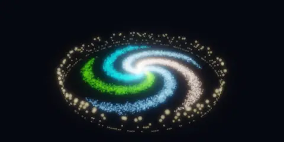
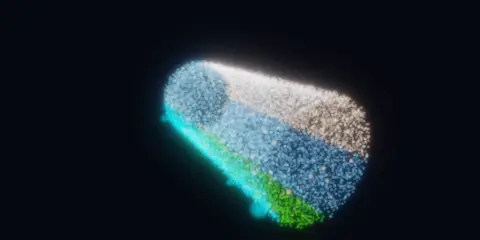
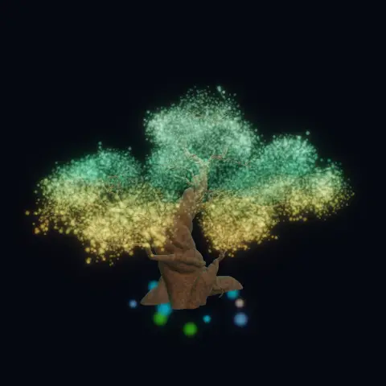
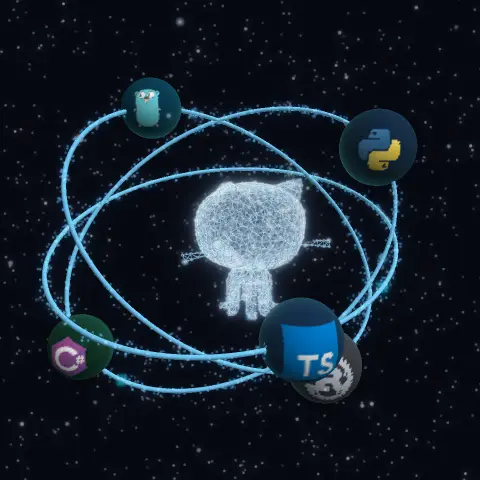
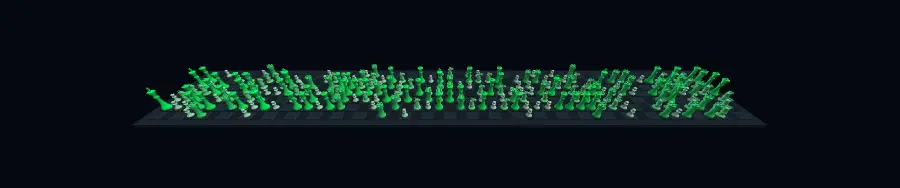
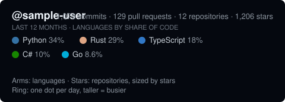
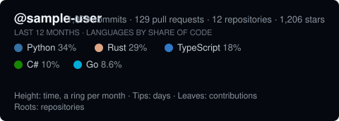
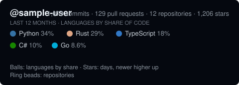
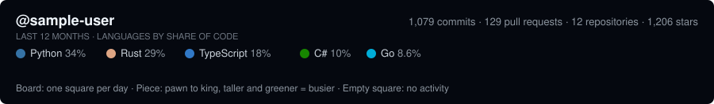

# Starforge

[](https://github.com/ShyneChikwapulo/Starforge/actions/workflows/ci.yml)

Turn your real GitHub activity into a living 3D visual for your profile README.

Starforge reads your public GitHub data, builds a deterministic 3D scene from it, and renders a
looping animation that a scheduled GitHub Action keeps up to date. The same scene also runs in an
interactive viewer, where you can orbit, zoom and hover to read the data behind every dot.

## Gallery

Five presets, each a different way of looking at the same data. Pick one with a single line of
config. Click an image to jump to its documentation, or open it in 3D.

<table>
  <tr>
    <td align="center" width="50%">
      <a href="#galaxy"></a>
      <br />
      <b><a href="#galaxy">Galaxy</a></b> · <a href="https://shynechikwapulo.github.io/Starforge/?preset=galaxy">explore in 3D</a>
      <br />
      Languages as spiral arms, repositories as stars, one ring dot per day
    </td>
    <td align="center" width="50%">
      <a href="#tunnel"></a>
      <br />
      <b><a href="#tunnel">Tunnel</a></b> · <a href="https://shynechikwapulo.github.io/Starforge/?preset=tunnel">explore in 3D</a>
      <br />
      Time as depth, the year as a spiral, languages as stripes
    </td>
  </tr>
  <tr>
    <td align="center">
      <a href="#tree"></a>
      <br />
      <b><a href="#tree">Tree</a></b> · <a href="https://shynechikwapulo.github.io/Starforge/?preset=tree">explore in 3D</a>
      <br />
      A solid tree that grows through your year, one leaf per contribution
    </td>
    <td align="center">
      <a href="#atom"></a>
      <br />
      <b><a href="#atom">Atom</a></b> · <a href="https://shynechikwapulo.github.io/Starforge/?preset=atom">explore in 3D</a>
      <br />
      Language logo balls orbiting a particle kitten of your year
    </td>
  </tr>
  <tr>
    <td align="center" colspan="2">
      <a href="#chess"></a>
      <br />
      <b><a href="#chess">Chess</a></b> · <a href="https://shynechikwapulo.github.io/Starforge/?preset=chess">explore in 3D</a>
      <br />
      A solid chessboard of your year: a square per day, and the busier the day, the stronger the piece
    </td>
  </tr>
</table>

These previews are rendered from built-in sample data, so you can reproduce them without a token
(see [Development](#development)). Yours will show your own languages, repositories and year.

## How it works

1. **Collect.** Starforge reads three things from the GitHub API: your contribution calendar for
   the last 12 months, your public repositories (the 100 with the most stars), and the languages
   you use, weighted by share of code.
2. **Build.** A preset turns that data into a 3D scene. Every dot that carries data is tied to a
   real thing: a day, a repository or a contribution. Everything else is decoration, and each
   preset below says which is which.
3. **Render.** The scene is rendered to a looping animation (animated WebP by default) and a
   caption strip that spells out what the picture means. The same scene runs in real time in the
   [interactive viewer](#explore-in-3d).

Everything is deterministic: the same data, preset and seed always produce the same picture.

## Quick start

1. In your profile repository (`<you>/<you>`), add `starforge.config.json`. Pick any preset from
   the [gallery](#gallery):

   ```json
   { "username": "your-github-login", "preset": "atom" }
   ```

2. Add `.github/workflows/starforge.yml` (see [`examples/workflows/starforge.yml`](examples/workflows/starforge.yml)).

3. Run the workflow once from the **Actions** tab, then add this to your profile `README.md`. The
   image is named after the preset, so the `atom` preset writes `atom.webp`:

   ```html
   <p align="center">
     
   </p>
   ```

## Presets

Choose one with `"preset"` in `starforge.config.json`. The interactive viewer has a switch between
all of them and morphs one into another (`?preset=tunnel` opens it directly).

| Preset   | Default size | Best for                                                                |
| -------- | ------------ | ----------------------------------------------------------------------- |
| `galaxy` | 800 × 400    | An at-a-glance overview of languages, repositories and the year         |
| `tunnel` | 800 × 400    | Seeing how your activity and projects unfold over time                  |
| `tree`   | 720 × 720    | A friendly picture of the year, with a leaf for every contribution      |
| `atom`   | 720 × 720    | Showing off the languages you use, with their logos                     |
| `chess`  | 960 × 200    | A solid, literal picture of every day: one square and one piece per day |

### Galaxy

<p align="center">
  
  <br />
  
</p>

```json
{ "username": "your-github-login", "preset": "galaxy" }
```

| Element                | Data it encodes                                                                                        |
| ---------------------- | ------------------------------------------------------------------------------------------------------ |
| Spiral arms            | Your top six languages. Colour is the language colour; density is the square root of its share of code |
| Bright stars on arms   | Your public repositories. Size is stars (log scale); older repositories sit closer to the core         |
| Ring particles         | One per day of the last year. Height and brightness follow that day's contributions                    |
| Shimmer and slow orbit | Decoration only; they carry no data                                                                    |

### Tunnel

<p align="center">
  
  <br />
  
</p>

```json
{ "username": "your-github-login", "preset": "tunnel" }
```

| Element                | Data it encodes                                                                                                |
| ---------------------- | -------------------------------------------------------------------------------------------------------------- |
| Depth along the tunnel | Time: the oldest day at the far end, the newest at the near end                                                |
| Spiral of dots         | One per day of the last year. A dot pointing inward means a busier day                                         |
| Stripes on the wall    | Your top six languages. A stripe's width is the square root of its share of your code                          |
| Bright nodes           | Your public repositories, ordered by age along the tunnel, sized by stars, coloured by language (forks dimmer) |
| Shimmer                | Decoration only                                                                                                |

### Tree

<p align="center">
  
  <br />
  
</p>

```json
{ "username": "your-github-login", "preset": "tree" }
```

| Element             | Data it encodes                                                                                                            |
| ------------------- | -------------------------------------------------------------------------------------------------------------------------- |
| Height of the crown | Time. One ring per calendar month, the oldest at the bottom; the days of a month sweep round their ring in date order      |
| Bright tips         | One per day. Dim when nothing happened, larger and brighter when busy                                                      |
| Glowing leaves      | One per contribution, clustered on that day's tip. Fresher leaves are brighter green; older ones fade through lime to gold |
| Roots               | Your public repositories. Size is stars, colour is the language colour (forks dimmer)                                      |
| Trunk and branches  | Decoration: a solid 3D model drawn crisp and lit, outside the glow                                                         |
| Foliage haze        | Decoration that follows activity; it is not a count                                                                        |

Leaf counts are honest. A day with N contributions grows exactly N leaves. Only past about 3,000
leaves, or on a very small particle budget, are the counts scaled down proportionally, and
hovering a leaf in the viewer then reads "part of N contributions that day".

### Atom

<p align="center">
  
  <br />
  
</p>

```json
{ "username": "your-github-login", "preset": "atom" }
```

| Element                                | Data it encodes                                                                                                           |
| -------------------------------------- | ------------------------------------------------------------------------------------------------------------------------- |
| Balls on the rings                     | Your top six languages. Radius follows the square root of the language's share of your code, and each ball wears its logo |
| Bright stars on the kitten             | One per day of the last year. Older days sit low and newer days high; dim when quiet, larger when busy                    |
| Beads on the rings                     | Your public repositories. Size is stars, colour is the language colour (forks dimmer)                                     |
| Rings, faint lines, glow and starfield | Decoration only                                                                                                           |

A few things worth knowing:

- Each ball completes whole revolutions per loop, so the animation loops seamlessly.
- Language logos come from [Devicon](https://devicon.dev). A language without a logo gets a plain
  ball in its GitHub colour.
- In the interactive viewer each ball turns to face you, and hovering one shows the language and
  its share of your code.

### Chess

<p align="center">
  
  <br />
  
</p>

```json
{ "username": "your-github-login", "preset": "chess" }
```

| Element                   | Data it encodes                                                                                                                                                                                                                         |
| ------------------------- | --------------------------------------------------------------------------------------------------------------------------------------------------------------------------------------------------------------------------------------- |
| Squares                   | One per day of the last year, laid out like GitHub's own graph: a column per week and a row per weekday, with Sunday furthest from the camera and the oldest week on the left                                                           |
| Piece on a square         | How busy the day was: pawn, knight, rook, queen or king. A busier day gets a taller, stronger green piece. Pieces are ranked by quartile of your own active days, so they show how a day compares with your other days, not a raw count |
| King                      | The busiest day or days, and only when they stand clear above the top quartile, so a very even year has none                                                                                                                            |
| Bare square               | A day with no activity                                                                                                                                                                                                                  |
| Checker pattern and board | Decoration only                                                                                                                                                                                                                         |

A few things worth knowing:

- Everything is solid: the board and the pieces are lit 3D meshes, with no glow. The particles in
  this preset give off no light. There is one per day so the viewer can explain a day on hover, and
  the rest exist so that presets can morph into one another.
- A year is 53 weeks across, so this is a wide banner (960 × 200 by default). The camera sways from
  side to side instead of orbiting, which keeps both ends of the board in view.

## Where the images live

The animation changes every day, and committing a new binary daily would bloat your repository
by hundreds of megabytes a year. With `publish-branch: starforge-assets` (as in the example
workflow), the Action publishes the images to that branch as a **single force-pushed commit**,
so no history accumulates. Only the small `starforge/metrics.json` snapshot is committed to your
main branch. Point your README at the raw URLs shown below.

The `publish-branch` input needs the workflow permission `contents: write`.

## Add the legend

Put the legend directly under the animation so visitors can see that it is data. The legend is
named after the preset, for example `atom-legend.svg`:

```html
<p align="center">
  
  <br />
  
</p>
```

## Explore in 3D

The animation is a compact teaser. The interactive viewer renders the same data in real time,
with far more particles. Drag to orbit, scroll to zoom, and hover a day, a repository, a leaf or a
language ball to read the data behind it. Link to it from your README with your own repository in
the query string:

```markdown
[Explore in 3D →](https://shynechikwapulo.github.io/Starforge/?repo=YOUR-LOGIN/YOUR-REPO)
```

The viewer reads `starforge/metrics.json` from that repository on GitHub, so nothing is uploaded
anywhere else. Optional parameters:

| Parameter                         | Default              | Meaning                                             |
| --------------------------------- | -------------------- | --------------------------------------------------- |
| `repo=owner/name`                 | none                 | Repository containing `starforge/metrics.json`      |
| `user=login`                      | none                 | Shortcut for `repo=login/login` (your profile repo) |
| `branch=name`                     | `main`               | Branch to read the metrics from                     |
| `preset=name`                     | `galaxy`             | `galaxy`, `tunnel`, `tree`, `atom` or `chess`       |
| `particles=n`                     | `12000`              | Particle count (1,000 to 60,000)                    |
| `seed=n`                          | `1`                  | Changes the scattered dust, not your data           |
| `bloom`, `exposure`, `brightness` | `0.35`, `1.2`, `0.9` | Lighting                                            |

With no `repo` or `user` it shows sample data.

## Configuration

All keys except `username` are optional.

| Key               | Default                                           | Meaning                                                                                                               |
| ----------------- | ------------------------------------------------- | --------------------------------------------------------------------------------------------------------------------- |
| `username`        | required                                          | GitHub login to visualise                                                                                             |
| `preset`          | `"galaxy"`                                        | `"galaxy"`, `"tunnel"`, `"tree"`, `"atom"` or `"chess"`. Output files are named after it, for example `atom.webp`     |
| `outputDir`       | `"starforge"`                                     | Where files are written                                                                                               |
| `format`          | `"webp"`                                          | `"webp"` (small, lossy) or `"apng"` (lossless, large)                                                                 |
| `width`, `height` | the preset's own size                             | Pixel size: width 32 to 1600, height 32 to 1000                                                                       |
| `frames`, `fps`   | `60`, `15`                                        | Loop length (2 to 240 frames) and speed (1 to 60)                                                                     |
| `quality`         | `80`                                              | Lossy WebP quality, 0 to 100                                                                                          |
| `bloom`           | `0.9`                                             | Glow strength, 0 to 3; `0` turns it off. Solid parts (the tree's wood, the atom's balls) never glow                   |
| `seed`            | `1`                                               | Changes the scattered dust, not your data                                                                             |
| `legend`          | `true`                                            | Also write `<preset>-legend.svg`, a caption strip that spells out the data                                            |
| `theme`           | `"dark"`                                          | `"dark"`, `"light"` or `"both"`. `both` also writes a second set named with `-light`, drawn for white pages           |
| `background`      | navy for a plain `dark` run, `"github"` otherwise | `"github"`, `"transparent"`, or a page colour such as `"#0d1117"` (see [Light and dark pages](#light-and-dark-pages)) |
| `saveMetrics`     | `true`                                            | Also write a `metrics.json` snapshot                                                                                  |

Smaller files are mostly a matter of size and length: the previews in the [gallery](#gallery) are
480 pixels wide, 48 frames at 16 fps, quality 70.

## Light and dark pages

Out of the box the images keep their dark navy background. To make them blend into the page,
set `theme`:

```json
{ "username": "your-github-login", "preset": "atom", "theme": "both" }
```

`both` writes the usual files and a second set for white pages, named with `-light`
(`atom-light.webp`, `atom-light-poster.png`, `atom-light-legend.svg`). Each set is painted on
GitHub's default page colour, `#0d1117` for dark and `#ffffff` for light, so it blends in on
GitHub's default dark and light themes and the files stay small. The light set is drawn in
darker, ink-like colours with a gentler glow, because a glow that suits a dark page would wash
out on a white one. Use `"theme": "light"` for only the light set. A run with `both` renders
twice, so it takes roughly twice as long.

### Choosing a background

| `background`    | What it does                                                                                                                            |
| --------------- | --------------------------------------------------------------------------------------------------------------------------------------- |
| left out        | The original navy for a plain `dark` run, and `"github"` for `light` and `both`                                                         |
| `"github"`      | `#0d1117` for the dark set and `#ffffff` for the light set. Small files. A faint edge shows on GitHub's other dark themes               |
| `"transparent"` | No page colour, so it blends into any theme. In our tests the files were four to five times larger, because the alpha is stored exactly |
| `"#rrggbb"`     | Your own page colour, for a single theme. With `both`, use `"github"` or `"transparent"` instead                                        |

Both sets must come from one run, because the Action publishes exactly the files of the run that
made them. Then let the page pick one with a `<picture>` element; the dark image is the default:

```html
<picture>
  <source
    media="(prefers-color-scheme: light)"
    srcset="https://raw.githubusercontent.com/YOUR-LOGIN/YOUR-REPO/starforge-assets/atom-light.webp"
  />
  
</picture>
```

Do the same for the legend, with `atom-light-legend.svg` and `atom-legend.svg`. The `<picture>`
element follows your browser's colour scheme, which matches GitHub's theme when GitHub is set to
follow your system.

## Privacy

Starforge reads public data only. Contribution counts come from GitHub's contribution calendar,
so if your profile shows private contributions, the totals include anonymised counts of them (no
repository names or details). No private repository is ever queried.

## Development

```bash
pnpm install
pnpm typecheck
pnpm test
GITHUB_TOKEN=$(gh auth token) pnpm --filter @starforge/cli starforge generate --config starforge.config.json
```

Animated WebP output needs libwebp's `img2webp` (`brew install webp`, or `apt-get install webp`).

To regenerate the [gallery](#gallery) previews from the built-in sample data, run `pnpm examples`.
It prints the command that publishes them to the `examples` branch, which the README links to.
The images live on that branch, not in `main`.

The 3D models and logos behind the `tree` and `atom` presets are baked into small data files by
scripts in [`scripts/`](scripts) (`bake-tree-model.ts`, `bake-atom-kitten.ts` and
`bake-language-icons.ts`). Only the baked results are committed.

## Credits

The `tree` preset's trunk and crown shape come from
["Stylized Tree"](https://sketchfab.com/3d-models/stylized-tree-2a00182b3ca4403da3f9e157184e4b42)
by [Daniel](https://sketchfab.com/danielpetrov), licensed under
[CC BY 4.0](http://creativecommons.org/licenses/by/4.0/). The ground and grass were removed, the
model was rescaled, its wood was re-meshed and its leaves were resampled as points. Only that baked
result is in this repository (`packages/presets/src/tree-silhouette-data.ts`);
`pnpm exec tsx scripts/bake-tree-model.ts` rebuilds it from the original download.

The `atom` preset's nucleus comes from
["Github_kitten"](https://sketchfab.com/3d-models/github-kitten-83d5a6d1a12b4427bbfd662fbc478f8d)
by [m.adityamondal2003](https://sketchfab.com/m.adityamondal2003), licensed under
[CC BY 4.0](http://creativecommons.org/licenses/by/4.0/). The model was posed at rest, rescaled
and resampled as points, with links between neighbouring points. Its language logos come from
[Devicon](https://devicon.dev) (MIT); the logos themselves are trademarks of their owners. Only the
baked results are in this repository (`packages/presets/src/atom-kitten-data.ts` and
`language-icons-data.ts`); `scripts/bake-atom-kitten.ts` and `scripts/bake-language-icons.ts`
rebuild them.

Starforge's 3D text is built from glyph outlines baked from
[Inter](https://rsms.me/inter/) SemiBold 4.1, licensed under the
[SIL Open Font License 1.1](licenses/Inter-OFL-1.1.txt). Only the baked triangle meshes are in
this repository (`packages/presets/src/text-font-data.ts`); `scripts/bake-text-font.ts` rebuilds
them. [`THIRD_PARTY_NOTICES.md`](THIRD_PARTY_NOTICES.md) lists every third-party work in this
repository.

## License

MIT
